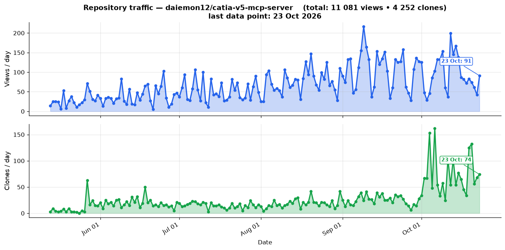

# CATIA V5 & 3DEXPERIENCE MCP Server

> Connect AI agents to Dassault Systemes CATIA V5 and CATIA 3DEXPERIENCE (V6) via the Model Context Protocol (MCP) — works with Claude, Cursor, Windsurf, Cline, VS Code, Codex and any MCP-compatible client.

[](https://github.com/daiemon12/catia-v5-mcp-server/releases)
[](https://github.com/daiemon12/catia-v5-mcp-server/actions/workflows/ci.yml)
[](LICENSE)
[](traffic/clones.json)
[](traffic/views.json)

The first open-source MCP server for CATIA V5, now also driving CATIA on the 3DEXPERIENCE platform. Drive parametric CAD modeling, measurement, drawing export and COM automation in natural language, from any AI agent that speaks MCP. The platform is detected when the server connects; the same tools work on both.



## What it does

This MCP server exposes **123 tools** that let an AI agent:

- **Create and manage documents** — new Part, Product (assembly), open, save, close; on 3DEXPERIENCE: 3D Parts / 3D Shapes / Physical Products in session, saved to the 3DSpace database
- **3DEXPERIENCE PLM** — search the database, open objects by title/revision, read and write PLM attributes, product tree
- **2D Sketching** — lines, rectangles, circles, arcs, splines, points, constraints; sketches on origin planes, plane elements or planar faces
- **Part Design** — Pad, Pocket, Shaft, Groove, Rib, Slot, Fillet, Chamfer, Hole, Shell, Draft, Thickness, Patterns (rectangular/circular/user), Mirror, multiple bodies and boolean operations, rename, activate/deactivate, show/hide, colors
- **Generative Shape Design (GSD)** — 3D wireframe (points, points on curves, lines, planes, splines, circles), Multi-sections Surface (loft), Sweep, Extrude, Revolve, Fill, Blend, Offset, Join, Split, Trim, Symmetry, Translate, Rotate, Extract, Shape Fillet, ThickSurface/CloseSurface to solids
- **Assembly** — add or insert components, Fix/Coincidence/Offset/Angle constraints (V5), move/rotate, product tree
- **Measurement** — distance, inertia, bounding box, per-element measures, parameters
- **Knowledgeware** — user parameters, formulas, design tables, relations
- **Export** — STEP, IGES, STL, 3DXML, VRML, screenshots
- **View control** — set standard views, fit all, capture screenshots
- **Drafting** — Drawing documents, generative views (axis- or face-driven), projection/section/detail views, 3D-driven dimensions, text and tables (experimental, field-contributed)
- **Diagnostics** — report the platform and CATIA release and probe which automation APIs the installation exposes
- **API discovery** — inspect the live automation API (members, parameters, enum values) from CATIA's type library, and optionally run VBScript inside CATIA (opt-in)

## Requirements

- **Windows** (COM automation is Windows-only)
- **CATIA V5** installed and licensed (R2016+), **or CATIA on the 3DEXPERIENCE platform** (the native app, started and logged in; see [CATIA 3DEXPERIENCE (V6)](#catia-3dexperience-v6))
- **Python 3.10+**
- Any **MCP client**: Claude Desktop, Claude Code, Cursor, Windsurf, Cline, VS Code (Copilot/MCP), Codex CLI, ChatGPT via an HTTP bridge, and others

### Compatibility notes (field reports)

- **V5R20 (2010)**: core workflow confirmed working end to end (document
  management, sketcher, Part Design pad creation, GSD geometrical sets,
  views, screenshots). An initial report of `ShapeFactory.AddNewPad` being
  missing turned out to be a **stale pywin32 `gen_py` cache**, not the
  release: clearing the cache restored the methods (see Troubleshooting).
  Measurement notes for R20: volume, area and parameters work directly;
  array-returning measures go through the SystemService.Evaluate detour
  (proven there for GetPlane; GetCOG and GetPoint use the same route and
  the same mm coordinate convention). The inertia matrix (Inertia object)
  and the vertex-sweep bounding box await live confirmation.
- **V5-6 2020**: full tool surface in active use by contributors.
- **Working alongside the agent**: a contributor reports dimensioning and
  testing by hand in the same CATIA session while an agent runs tools in
  the background, for a whole night, without conflicts. The automation
  layer is nearly invisible to the interactive user. The one thing to
  avoid is switching the active document while a tool call is in flight,
  since most tools resolve "the active document" at call time.

`catia_measure_distance` accepts tree names (`Pad.1`, `Sketch.2`) and indexed
topology (`Face.N` / `Edge.N` from `catia_list_faces` / `catia_list_edges`).
The topology path follows a V5R20 field diagnosis (selection Reference
property instead of `CreateReferenceFromObject`, which rejects HSO topology)
and awaits live confirmation on real CATIA; reports welcome.

Reports from other releases are welcome, open an issue with your CATIA version
and the tool results (the `catia_diagnose` tool output is the ideal payload).

## CATIA 3DEXPERIENCE (V6)

The server drives CATIA on the 3DEXPERIENCE platform through the same COM
ProgID (`CATIA.Application`) and the same tools. The platform is detected on
`catia_connect` (override with `--platform 3dx|v5` or the
`CATIA_MCP_PLATFORM` environment variable). What changes underneath:

| Concept | CATIA V5 | CATIA 3DEXPERIENCE |
|---------|----------|--------------------|
| Active content | `ActiveDocument.Part` | `ActiveEditor.ActiveObject` (3D Shape level) or root occurrence → `RepInstances` → `GetItem("Part")` (3D Part level) |
| New part / product / drawing | `Documents.Add` | `PLMNewService.PLMCreate` ("3DPart" or "3DShape", "VPMReference", "Drawing") |
| Open | file path | `catia_search_database` / `catia_open_from_database` (Search + PLMOpen) |
| Save | file Save / Save As | `PLMPropagateService` (writes to the shared 3DSpace database) |
| Selection | `Document.Selection` | `Editor.Selection` |
| Measure | `SPAWorkbench` | `MeasurableService` / `InertiaService` editor services |
| Assembly | `Products`, constraints | occurrences / instances; insert by copy-paste; engineering connections are not scriptable |
| Drawing views | `GenerativeBehavior` | `DrawingDefineGenView` factory, bound from the live type information |

Part Design, GSD, sketcher and knowledgeware tools use the same factory APIs
on both platforms once the Part is resolved. What does not port, and why,
is listed in [docs/3dexperience.md](docs/3dexperience.md): file export of
database content, assembly constraints, face-driven drawing views, and
scripted creation of 3D Parts / Physical Products on sites without the
matching licence (the server falls back to a 3D Shape and says so).

**Validation status.** The 3DEXPERIENCE paths were built from the published
3DEXPERIENCE automation object model and field-reported macros, and are
covered by offline contract tests. The live smoke test passes on
3DEXPERIENCE R428 SP6 (51 passed, 2 expected skips: STEP export and drawing
a standalone 3D Shape); other releases are not yet validated. Run
`python scripts/live_smoke_test.py` on your machine (it builds and measures
a throw-away part, saves nothing; add `--plm-type 3DShape` without the 3D
Part licence) and report the JSON it writes, together with `catia_diagnose`
output. When a tool reports `UNSUPPORTED_CAPABILITY`, `catia_inspect_api`
shows what your release exposes.

## Quick Install (Recommended)

```bash
git clone https://github.com/daiemon12/catia-v5-mcp-server.git
cd catia-v5-mcp-server
bash setup.sh
```

The script handles everything: dependencies, Claude Desktop configuration, and verification. Using another MCP client? See the per-client setup below.

## Manual Installation

### 1. Clone the repository

```bash
git clone https://github.com/daiemon12/catia-v5-mcp-server.git
cd catia-v5-mcp-server
```

### 2. Install dependencies

```bash
pip install -e .
```

Or manually:
```bash
pip install mcp pywin32
```

### 3. Connect your MCP client

The server speaks standard MCP over stdio, so it works with every
MCP-compatible client. The command is always the same:
`python -m catia_mcp` (or an absolute path to `catia_mcp/server.py`).

<details>
<summary><b>Claude Desktop</b></summary>

Edit the config file:
- Windows: `%APPDATA%\Claude\claude_desktop_config.json`
- macOS: `~/Library/Application Support/Claude/claude_desktop_config.json`

```json
{
  "mcpServers": {
    "catia-v5": {
      "command": "python",
      "args": ["-m", "catia_mcp"]
    }
  }
}
```
</details>

<details>
<summary><b>Claude Code</b></summary>

```bash
claude mcp add catia-v5 python -- -m catia_mcp
```
</details>

<details>
<summary><b>Cursor</b></summary>

Add to `~/.cursor/mcp.json` (or `.cursor/mcp.json` in your project):

```json
{
  "mcpServers": {
    "catia-v5": {
      "command": "python",
      "args": ["-m", "catia_mcp"]
    }
  }
}
```
</details>

<details>
<summary><b>Windsurf</b></summary>

Add to `~/.codeium/windsurf/mcp_config.json`:

```json
{
  "mcpServers": {
    "catia-v5": {
      "command": "python",
      "args": ["-m", "catia_mcp"]
    }
  }
}
```
</details>

<details>
<summary><b>Cline</b></summary>

In VS Code: Cline icon > MCP Servers > Configure, then add:

```json
{
  "mcpServers": {
    "catia-v5": {
      "command": "python",
      "args": ["-m", "catia_mcp"]
    }
  }
}
```
</details>

<details>
<summary><b>VS Code (GitHub Copilot / native MCP)</b></summary>

Add to `.vscode/mcp.json`:

```json
{
  "servers": {
    "catia-v5": {
      "type": "stdio",
      "command": "python",
      "args": ["-m", "catia_mcp"]
    }
  }
}
```
</details>

<details>
<summary><b>Codex CLI (OpenAI)</b></summary>

Add to `~/.codex/config.toml`:

```toml
[mcp_servers.catia-v5]
command = "python"
args = ["-m", "catia_mcp"]
```
</details>

<details>
<summary><b>ChatGPT (desktop / web)</b></summary>

ChatGPT only connects to remote MCP servers over HTTP, not to local
stdio processes. Expose this server through a stdio-to-HTTP bridge such
as `mcp-proxy` or `supergateway` on the CATIA machine, then add the
resulting URL as a connector in ChatGPT's developer mode. A native HTTP
transport is on the roadmap.
</details>

<details>
<summary><b>Other MCP hosts</b></summary>

Any client that launches stdio MCP servers works: configure a server
named `catia-v5` with command `python` and args `["-m", "catia_mcp"]`,
run from a machine where CATIA V5 is installed.
</details>

### Remote use: agent on a Mac or another machine

CATIA only runs on Windows, but the agent does not have to. Start the server
in HTTP mode next to CATIA (local PC or cloud workstation) and connect from a
Mac with Claude Code, Cursor, VS Code or Claude Desktop:

```bat
catia-mcp --new-token
set CATIA_MCP_TOKEN=<token>
catia-mcp --http --host 0.0.0.0
```

The server refuses to listen beyond localhost without a token, and should be
reached through a private network such as Tailscale or an SSH tunnel, never
the open internet. Full setup and client configurations:
[docs/remote-access.md](docs/remote-access.md).

### 4. Start CATIA

Make sure CATIA is running before asking your agent to interact with it. The server will automatically connect to the running instance and detect whether it is CATIA V5 or CATIA 3DEXPERIENCE.

If CATIA V5 is not running, the server will attempt to launch it (requires CATIA to be registered as COM server: `cnext.exe /regserver`). For 3DEXPERIENCE, start the native app from the 3DEXPERIENCE launcher and log in to your platform and collaborative space before connecting.

Optional server flags: `--platform auto|v5|3dx` forces the platform;
`--allow-scripts` enables `catia_run_script` (VBScript inside CATIA with
your full rights; off by default).

## Usage Examples

Once configured, just talk to your AI agent:

### Create a simple part
> "Create a new CATIA part. Draw a 100x60mm rectangle centered at the origin on the XY plane, then extrude it 40mm."

### Design a bracket
> "Design a mounting bracket: start with a 120x80mm base plate, 5mm thick. Add 4 M6 mounting holes at the corners with 10mm edge distance. Then add two vertical ribs 30mm tall."

### Parametric modification
> "Show me all parameters of the active part. Then change the pad height to 60mm."

### Export for manufacturing
> "Export the current part to STEP format at C:/export/bracket.stp and take a screenshot of the isometric view."

### Assembly
> "Create a new assembly. Add the bracket from C:/parts/bracket.CATPart and the base from C:/parts/base.CATPart. Fix the base, then create a coincidence constraint between the two."

### 3DEXPERIENCE
> "Find the 3D Part titled 'Bracket' in the database, open revision B.1, add a 2 mm fillet on Edge.4, measure its mass, then save it."

## Architecture

```
catia-v5-mcp-server/
├── catia_mcp/
│   ├── __init__.py
│   ├── __main__.py          # python -m catia_mcp entry point
│   ├── server.py            # MCP Server — tool registration & routing
│   ├── connection.py        # COM connection + V5 / 3DEXPERIENCE platform layer
│   ├── plm.py               # 3DEXPERIENCE PLM services (create, open, save, search, attributes)
│   ├── measure.py           # Measurement backend (SPAWorkbench / MeasurableService)
│   ├── references.py        # Named element and Face.N / Edge.N resolution
│   ├── automation.py        # COM helpers (out-parameters via SystemService.Evaluate)
│   ├── introspect.py        # Live type-library reading (members, enums)
│   ├── errors.py            # Typed tool failures (stable error codes)
│   ├── http_transport.py    # Optional remote access (Streamable HTTP + token)
│   └── tools/
│       ├── __init__.py
│       ├── document.py      # Documents / editors (10 tools)
│       ├── plm.py           # 3DEXPERIENCE database + product tree (5 tools)
│       ├── sketcher.py      # 2D Sketch tools (11 tools)
│       ├── part_design.py   # 3D Part Design features, bodies, booleans (27 tools)
│       ├── gsd.py           # Generative Shape Design — wireframe & surfaces (29 tools)
│       ├── assembly.py      # Assembly/Product tools (10 tools)
│       ├── measurement.py   # Measurement & analysis (7 tools)
│       ├── drawing.py       # Drafting: drawings, views, dimensions, text & tables (12 tools)
│       ├── knowledge.py     # Knowledgeware: parameters, formulas, design tables (5 tools)
│       ├── diagnostics.py   # Installation diagnostics (1 tool)
│       ├── introspection.py # API discovery and opt-in scripting (2 tools)
│       └── export.py        # Export & view control (4 tools)
├── pyproject.toml
├── requirements.txt
└── README.md
```

### How it works

```
AI agent (Claude, Cursor, Windsurf, Cline, ...)
    │
    │ stdio (MCP JSON-RPC)
    ▼
catia_mcp/server.py (MCP Server)
    │
    │ Tool routing
    ▼
catia_mcp/tools/*.py (Tool modules)
    │
    │ connection.py: platform layer (active Part, selection, services)
    │ win32com.client (COM Automation)
    ▼
CATIA V5 Application  |  CATIA 3DEXPERIENCE (native app)
```

1. The MCP client sends tool calls over stdio
2. The server routes each call to the appropriate tool module
3. Each tool module asks the platform layer for the active Part, body,
   selection or service, then drives CATIA via COM on one serialized
   STA worker thread
4. Results (JSON, text) are returned to the agent

## Tool Reference

Tools work on both platforms unless marked **V5** or **3DX**.

### Document Tools (10)
| Tool | Description |
|------|-------------|
| `catia_connect` | Connect to CATIA (platform detected) |
| `catia_disconnect` | Disconnect from CATIA |
| `catia_new_part` | New Part (V5 CATPart; 3DX 3D Part, falling back to 3D Shape) |
| `catia_new_product` | New Product (V5 CATProduct; 3DX Physical Product, licence permitting) |
| `catia_open_document` | Open a file (**V5**; 3DX only where `Documents.Open` exists) |
| `catia_save_document` | Save / Save As (V5); save to the 3DSpace database (3DX) |
| `catia_close_document` | Close active document / editor window |
| `catia_list_documents` | List open documents (V5) or editors (3DX) |
| `catia_get_active_document_info` | Detailed info: bodies, features, geosets, PLM attributes |
| `catia_activate_document` | Bring a document / editor window to the front |

### 3DEXPERIENCE PLM Tools (5)
| Tool | Description |
|------|-------------|
| `catia_search_database` | **3DX** Search 3DSpace by title or attribute (wildcards) |
| `catia_open_from_database` | **3DX** Open by title, revision or result index; never guesses between matches |
| `catia_get_plm_attributes` | **3DX** Read PLM attributes of the active object |
| `catia_set_plm_attributes` | **3DX** Set PLM attributes (in session until saved) |
| `catia_get_product_tree` | Product structure tree (V5 products, 3DX occurrences) |

### Sketcher Tools (11)
| Tool | Description |
|------|-------------|
| `catia_create_sketch` | Create sketch on XY/YZ/ZX, a plane element, or a planar face |
| `catia_close_sketch` | Close sketch, return to Part Design |
| `catia_sketch_line` | Draw a line |
| `catia_sketch_rectangle` | Draw a rectangle (2 corners) |
| `catia_sketch_centered_rectangle` | Draw a centered rectangle |
| `catia_sketch_circle` | Draw a circle |
| `catia_sketch_arc` | Draw an arc |
| `catia_sketch_spline` | Draw a spline through points |
| `catia_sketch_point` | Create a point |
| `catia_sketch_constraint` | Add dimensional/geometric constraint |
| `catia_sketch_get_geometry` | List sketch geometry elements |

### Part Design Tools (27)
| Tool | Description |
|------|-------------|
| `catia_pad` | Pad (extrusion) |
| `catia_pocket` | Pocket (cut extrusion) |
| `catia_shaft` | Shaft (revolution) |
| `catia_groove` | Groove (revolution cut) |
| `catia_fillet` | Fillet (edge rounding) |
| `catia_chamfer` | Chamfer (edge bevel) |
| `catia_hole` | Hole (simple, counterbored, countersunk) |
| `catia_rect_pattern` | Rectangular pattern |
| `catia_circ_pattern` | Circular pattern around a chosen axis and center |
| `catia_user_pattern` | User pattern: copies placed on the points of a sketch |
| `catia_mirror` | Mirror about a plane |
| `catia_shell` | Shell (hollow out) |
| `catia_draft` | Draft angle |
| `catia_thickness` | Thickness offset |
| `catia_list_features` | List features in body |
| `catia_delete_feature` | Delete a feature by name |
| `catia_list_edges` | List edges of the final solid as indexed Edge.N names |
| `catia_list_faces` | List faces of the final solid as indexed Face.N names |
| `catia_rib` | Rib: sweep a profile along a center curve (adds material) |
| `catia_slot` | Slot: sweep a profile along a center curve (removes material, verified) |
| `catia_add_body` | Add a body and make it the active body |
| `catia_set_active_body` | Choose the body receiving new features |
| `catia_boolean` | Add / remove / intersect / assemble a body into another |
| `catia_rename_feature` | Rename a feature, sketch, body or GSD element |
| `catia_set_feature_active` | Activate or deactivate a feature |
| `catia_set_visibility` | Show or hide elements |
| `catia_set_color` | Set element display colors |

### Generative Shape Design Tools (29)
| Tool | Description |
|------|-------------|
| `catia_gsd_create_geoset` | Create a Geometrical Set and make it active |
| `catia_gsd_set_active_geoset` | Select the target Geometrical Set |
| `catia_gsd_list_elements` | List geosets, wireframe/surface elements, sketches |
| `catia_gsd_point` | 3D point at (x, y, z) |
| `catia_gsd_line` | 3D line between two points |
| `catia_gsd_plane_offset` | Plane offset from a reference plane |
| `catia_gsd_plane_3points` | Plane through three points |
| `catia_gsd_spline` | 3D spline through points |
| `catia_gsd_circle` | 3D circle on a support plane |
| `catia_gsd_project` | Project a curve/point onto a support |
| `catia_gsd_intersection` | Intersection of two elements |
| `catia_gsd_multi_section_surface` | Multi-sections Surface (loft) through sections + guides |
| `catia_gsd_sweep` | Swept surface (profile along guide) |
| `catia_gsd_extrude` | Extruded surface along a direction |
| `catia_gsd_revolve` | Surface of revolution around an axis |
| `catia_gsd_fill` | Fill surface from boundary curves |
| `catia_gsd_blend` | Blend surface between two curves |
| `catia_gsd_offset_surface` | Offset surface |
| `catia_gsd_join` | Join curves/surfaces into one element |
| `catia_gsd_split` | Split an element by a cutter |
| `catia_gsd_trim` | Mutual trim of two elements |
| `catia_gsd_symmetry` | Mirror an element about a plane |
| `catia_gsd_thick_surface` | Surface → solid by thickness (Part Design) |
| `catia_gsd_close_surface` | Closed surface → solid (Part Design) |
| `catia_gsd_translate` | Translate an element along a vector |
| `catia_gsd_rotate` | Rotate an element around an axis |
| `catia_gsd_point_on_curve` | Point at a fraction of a curve's length |
| `catia_gsd_extract` | Extract a face/edge (Face.N / Edge.N) or element |
| `catia_gsd_shape_fillet` | Bi-tangent shape fillet between two surfaces |

### Assembly Tools (10)
| Tool | Description |
|------|-------------|
| `catia_add_component` | **V5** Add an existing part/product file to the assembly |
| `catia_add_new_part` | Create a new part in the assembly (3DX: 3D Part pasted under the root, verified) |
| `catia_insert_existing_component` | **3DX** Insert a database product/part under the root (verified by child count) |
| `catia_fix_constraint` | **V5** Fix a component in place |
| `catia_coincidence_constraint` | **V5** Coincidence constraint |
| `catia_offset_constraint` | **V5** Offset constraint |
| `catia_angle_constraint` | **V5** Angle constraint |
| `catia_move_component` | Move/rotate a component about its own origin |
| `catia_list_components` | List components with positions |
| `catia_list_constraints` | List constraints (V5) or engineering connections (3DX) |

### Measurement Tools (7)
| Tool | Description |
|------|-------------|
| `catia_measure_distance` | Measure distance between elements |
| `catia_get_inertia` | Volume, area, mass, center of gravity |
| `catia_get_bounding_box` | Bounding box from a vertex sweep of the final shape |
| `catia_get_parameters` | List all parameters |
| `catia_set_parameter` | Modify a parameter value |
| `catia_update_part` | Force rebuild |
| `catia_measure_element` | Volume / area / length / radius / point of one element |

### Export Tools (4)
| Tool | Description |
|------|-------------|
| `catia_export` | Export to STEP/IGES/STL/3DXML/VRML (**V5**; 3DX only where a document with ExportData exists) |
| `catia_screenshot` | Capture 3D view to image |
| `catia_set_view` | Set view orientation |
| `catia_fit_all` | Fit all in view |

### Drafting Tools (12) — experimental
| Tool | Description |
|------|-------------|
| `catia_new_drawing` | Create a Drawing document (CATDrawing) |
| `catia_drawing_add_view` | Add a generative view of a part or a single body: xy/yz/zx projection, or face-driven (projected on a chosen planar face), with in-plane rotation |
| `catia_drawing_projection_view` | Right/left/top/bottom/rear projection of an existing view |
| `catia_drawing_section_view` | Section view or section cut along a polyline profile |
| `catia_drawing_detail_view` | Circular detail view of a region |
| `catia_drawing_add_text` | Text annotation in a view (Background View for title blocks) |
| `catia_drawing_add_table` | Table with optional cell contents (title blocks, revision tables, BOM) |
| `catia_drawing_generate_dimensions` | Generate associative dimensions from the part's 3D sketch constraints (the only route to dimension generated geometry in V5) |
| `catia_drawing_list_dimensions` | List a view's dimensions with values and status |
| `catia_drawing_list_view_geometry` | List a view's manually drawn 2D geometry (generated curves are not exposed by CATIA) |
| `catia_drawing_add_dimension` | Add a dimension between manually drawn 2D elements |
| `catia_drawing_list_views` | List sheets and views of the active drawing |

### Knowledgeware Tools (5)
| Tool | Description |
|------|-------------|
| `catia_create_parameter` | Create or set a user parameter (length, angle, real, integer, string, boolean) |
| `catia_set_formula` | Create or update a formula driving a parameter |
| `catia_list_relations` | List formulas, design tables, rules and checks |
| `catia_delete_relation` | Delete a relation by name |
| `catia_create_design_table` | Create a design table from a sheet and associate parameters |

### Diagnostics (1)
| Tool | Description |
|------|-------------|
| `catia_diagnose` | Report platform, CATIA version/release/SP and probe which automation APIs (and on 3DX, PLM services) this installation exposes. Run it first when tools fail with UNSUPPORTED_CAPABILITY, and paste its output in compatibility reports |

### API Discovery (2)
| Tool | Description |
|------|-------------|
| `catia_inspect_api` | Read-only: list members, parameters and enum values of a live object (e.g. `part.ShapeFactory`, `editor.GetService("MeasurableService")`) |
| `catia_run_script` | Run VBScript inside CATIA; disabled unless the server runs with `--allow-scripts` |

## Troubleshooting

### Structured tool errors and cancellation

Errors returned by the server boundary for all tools set MCP
`isError=true` and include `structuredContent` with `ok=false`, `code`,
`message`, `operation_id`, `tool`, `data`, `effects`, `diagnostics`, `warnings`
and `recovery`. The text content contains the same JSON. Clients should inspect
`isError` and the error code rather than matching a plain-text error phrase.
Codes include `INVALID_ARGUMENT`, `NO_ACTIVE_DOCUMENT`, `WRONG_DOCUMENT_TYPE`,
`OBJECT_NOT_FOUND`, `AMBIGUOUS_TARGET`, `UNSUPPORTED_CAPABILITY`,
`PERMISSION_DENIED` and `COM_ERROR`; `effects.modified=false` means the
failure was detected before CATIA was touched.

An ordinary exception, including `ValueError`, does not block the next call.
Cancelling a request does not cancel its COM operation: the STA worker finishes
that operation before running queued calls. Cancellation does not prove rollback.
A modal dialog can still block the worker; resolve it in CATIA before continuing.
See [runtime behavior and recovery](docs/server-runtime.md).

### "AttributeError" on methods that should exist (AddNewPad, etc.)
A stale pywin32 COM cache is the most common cause, confirmed in the field:
methods that genuinely exist stop resolving. Delete the generated bindings
cache and restart the server:
```
%LOCALAPPDATA%\Temp\gen_py\        (or %TEMP%\gen_py\)
```
Close CATIA and the MCP server first, delete the whole `gen_py` folder, then
restart. Run `catia_diagnose` to verify which APIs resolve afterwards.

### "pywin32 is not installed"
```bash
pip install pywin32
```
This server requires Windows to drive CATIA. Agents on macOS or Linux connect
to it remotely (see Remote use); the offline test suite runs anywhere.

### "Failed to connect to CATIA"
1. Make sure CATIA is running (3DEXPERIENCE: started from the launcher and logged in)
2. CATIA V5: register CATIA as COM server: navigate to `C:\Program Files\Dassault Systemes\B<version>\<os>\code\bin\` and run `cnext.exe /regserver`
3. With both V5 and 3DEXPERIENCE installed, `CATIA.Application` points to whichever registered last; start only the one you want, or re-register it
4. Check that no modal dialog is blocking CATIA

### "No active document" / "No active editor"
Create or open content first: `catia_new_part`, `catia_open_document` (V5) or
`catia_open_from_database` (3DEXPERIENCE).

### 3DEXPERIENCE: "Operation not authorized" when creating content
Scripted creation of 3D Parts and Physical Products needs a licence/role many
sites do not grant. `catia_new_part` falls back to a 3D Shape; for products,
create them in the UI or open an existing one. See
[docs/3dexperience.md](docs/3dexperience.md).

### COM ByRef array limitations
Some measurement methods may not work with late binding. If you encounter issues, try using `pycatia` as an alternative backend (contribution welcome).

## Contributing

This project is open-source. See [CONTRIBUTING.md](CONTRIBUTING.md) for guidelines. Contributions welcome:

- **Drafting** extras: frames and title-block generators, BOM automation
- **pycatia backend** as alternative to raw win32com
- **3DEXPERIENCE live reports**: `scripts/live_smoke_test.py` results and
  `catia_diagnose` output from your release

## Services and support

The server is free and MIT licensed. If your company runs CATIA V5 and
wants to go further, the maintainer is available for paid work:

- **Custom tools**: new MCP tools for your workflows (drawing frames and
  title blocks, BOM automation, Knowledgeware templates, batch exports).
- **Macro modernization**: turning legacy VBA/CATScript macros into
  agent-callable tools, or auditing them before migration.
- **Pilot and training**: a one-day workshop on agent-driven CATIA
  automation, followed by a pilot on one of your real parts.
- **Priority support**: a dedicated channel and response times for teams
  running the server in production.

Contact: open a discussion on GitHub, join the
[Discord](https://discord.gg/S6Yq6kFaa), or reach the maintainer on
[LinkedIn](https://www.linkedin.com/in/adam-m-hamdi/). Sponsorship
through GitHub Sponsors keeps the free version maintained.

## License

MIT

## Credits

Inspired by:
- [SolidWorks-MCP](https://github.com/Sam-Of-The-Arth/SolidWorks-MCP)
- [freecad-mcp](https://github.com/contextform/freecad-mcp)
- [abaqus-mcp-server](https://github.com/jianzhichun/abaqus-mcp-server)
- [pycatia](https://github.com/evereux/pycatia)
